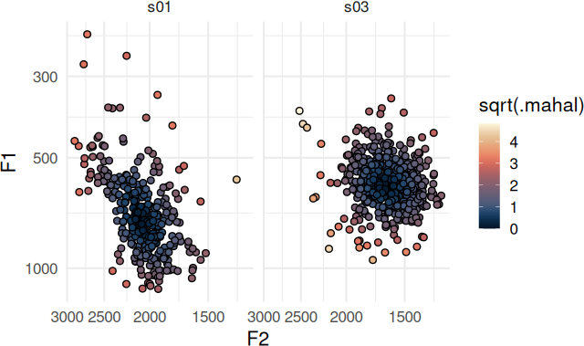
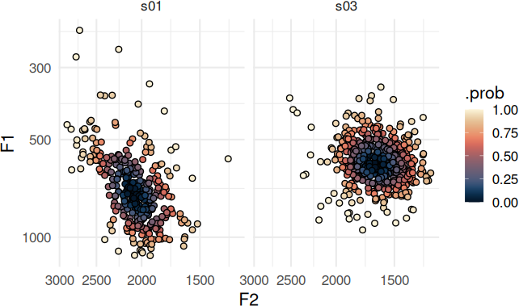
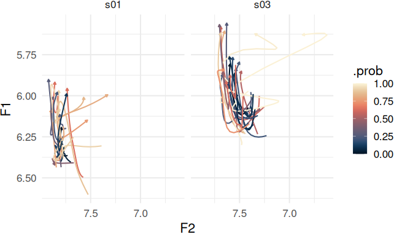
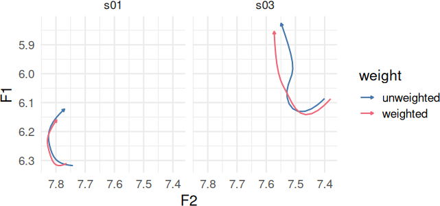

# Managing Outliers

``` r

library(tidynorm)
library(dplyr)
library(tidyr)
library(ggplot2)
library(ggdensity)
library(khroma)
library(tinytable)
```

Theme setup

``` r

theme_set(
  theme_minimal(
    base_size = 16
  ) +
    theme(
      palette.colour.continuous = as.character(color(palette = "lipari")(50)),
      palette.color.discrete = color(palette = "bright")
    )
)
```

## Quick Overview

Stanley ([2022](#ref-stanleyOrderOperationsSociophonetic2022)) proposes
an order of operations for sociophonetic analysis as follows:

1.  Identify allophone categories.
2.  Identify outliers by allophone category.
3.  Carry out speaker normalization.

It’s beyond the scope of
[tidynorm](https://jofrhwld.github.io/tidynorm/) to define a pipeline
for identifying allophone categories, since these will be extremely
language, dialect, and label-set specific. I would recommend reviewing
the general purpose
[`dplyr::case_when()`](https://dplyr.tidyverse.org/reference/case-and-replace-when.html)
and
[`dplyr::recode_values()`](https://dplyr.tidyverse.org/reference/recode-and-replace-values.html),
or
[`joeyr::code_allophones()`](https://joeystanley.github.io/joeyr/reference/code_allophones.html)
for this step.

The second and third steps can be achieved in
[tidynorm](https://jofrhwld.github.io/tidynorm/) by

2.  using
    [`identify_outliers()`](https://jofrhwld.github.io/tidynorm/reference/identify_outliers.md),
    [`identify_track_outliers()`](https://jofrhwld.github.io/tidynorm/reference/identify_track_outliers.md)
    or
    [`identify_dct_outliers()`](https://jofrhwld.github.io/tidynorm/reference/identify_dct_outliers.md)
    to add an `.outlier` column to your vowel data frame.
3.  passing the `.outlier` column to `.exclude` in your normalization
    function.

Here is how
[`identify_outliers()`](https://jofrhwld.github.io/tidynorm/reference/identify_outliers.md)
can be incorporated into a workflow normalizing point measures.

``` r

speaker_data |>
  identify_outliers(
    # Use F1 through F3 to identify outliers
    F1:F3,

    # Identify outliers within speaker and
    # within vowel class
    .by = c(speaker, plt_vclass),

    # The probability level beyond which
    # rows are marked as outliers
    .level = 0.95
  ) |>
  norm_nearey(
    F1:F3,
    .by = speaker,

    # exclude rows marked as outliers
    .exclude = .outlier,
  ) ->
normed
#> Normalization info
#> • outliers identified along `F1`, `F2`, and `F3`
#> • grouped by `speaker` and `plt_vclass`
#> • outlier probability level: 0.95
#> 
#> 
#> Normalization info
#> • normalized with `tidynorm::norm_nearey()`
#> • normalized `F1`, `F2`, and `F3`
#> • normalized values in `F1_lm`, `F2_lm`, and `F3_lm`
#> • grouped by `speaker`
#> • within formant: FALSE
#> • exclusion: .outlier
#> • transformation prior to normalization: log
#> • (.formant - mean(.formant, na.rm = T))/(1)
```

- Both
  [`identify_track_outliers()`](https://jofrhwld.github.io/tidynorm/reference/identify_track_outliers.md)
  and
  [`identify_dct_outliers()`](https://jofrhwld.github.io/tidynorm/reference/identify_dct_outliers.md)
  require a `.token_id_col` argument.

- [`identify_dct_outliers()`](https://jofrhwld.github.io/tidynorm/reference/identify_dct_outliers.md)
  requires a `.param_col` argument.

It’s worth noting that passing an expression to `.exclude` only excludes
data from the calculation of the normalization parameters. All data
points get normalized, so to remove outliers from the rest of your
analysis flow, you’ll need to do some additional filtering.

``` r

nrow(speaker_data)
#> [1] 10697
nrow(normed)
#> [1] 10697
```

## Details

### General Info

The family of outlier identification functions add three new columns the
input data frames:

- `.mahal`:

  The squared Mahalanobis distance.

- `.prob`:

  The probability of observing a value of `.mahal` this extreme or less.
  Based on the cumulative chi-squared probability distribution.

- `.outlier`:

  A logical vector indicating whether the vowel token exceeded the
  probability `.level` specified.

The Mahalanobis distance can be thought of as a multi-dimensional
z-score. For example, the two speakers in `speaker_data` have very
different distributions for their \[æ\] vowel, and the outlier status
for each token is specific to the shape of the distribution for each
speaker for each vowel.

``` r

speaker_data |>
  identify_outliers(
    F1:F2,
    .by = c(speaker, plt_vclass)
  ) |>
  filter(
    plt_vclass == "ae"
  ) ->
ae_identified
#> Normalization info
#> • outliers identified along `F1` and `F2`
#> • grouped by `speaker` and `plt_vclass`
#> • outlier probability level: 0.99
```

Plotting Code

``` r

ae_identified |>
  ggplot(
    aes(F2, F1)
  ) +
  geom_point(
    aes(fill = sqrt(.mahal)),
    shape = 21
  ) +
  scale_y_continuous(
    trans = c("log10", "reverse")
  ) +
  scale_x_continuous(
    trans = c("log10", "reverse")
  ) +
  expand_limits(
    fill = 0
  ) +
  facet_wrap(~speaker)
```



The `.prob` column is based on the chi-squared cumulative probability
density function with degrees of freedom equal to the number of data
dimensions.

Plotting Code

``` r

ae_identified |>
  ggplot(
    aes(F2, F1)
  ) +
  geom_point(
    aes(fill = .prob),
    shape = 21
  ) +
  scale_y_continuous(
    trans = c("log10", "reverse")
  ) +
  scale_x_continuous(
    trans = c("log10", "reverse")
  ) +
  scale_fill_continuous(
    limits = c(0, 1)
  ) +
  facet_wrap(~speaker)
```



### DCT and Track Outlier Identification

If you have a data frame of DCT coefficients by formant,
[`identify_dct_outliers()`](https://jofrhwld.github.io/tidynorm/reference/identify_dct_outliers.md)
will treat each DCT parameter for each formant as a data dimension over
which the Mahalanobis distance is calculated. For
[`identify_track_outliers()`](https://jofrhwld.github.io/tidynorm/reference/identify_track_outliers.md)
each formant track first has the DCT transform applied, and then the
Mahalanobis distance is calculated in the same way as
[`identify_dct_outliers()`](https://jofrhwld.github.io/tidynorm/reference/identify_dct_outliers.md).

``` r

speaker_tracks |>
  identify_track_outliers(
    F1:F2,
    .by = c(speaker, plt_vclass),
    .token_id_col = id,
    .time_col = t,
    # DCT order
    .order = 5,
    .pre_trans = log,
    .return_dct = TRUE
  ) |>
  filter(plt_vclass == "ey") ->
ey_identified
#> Normalization info
#> • outliers identified along `F1` and `F2`
#> • grouped by `speaker` and `plt_vclass`
#> • outlier probability level: 0.99
```

Plotting Code

``` r

ey_identified |>
  reframe_with_idct(
    F1:F2,
    .by = c(speaker, id),
    .param_col = .param
  ) |>
  ggplot(
    aes(F2, F1)
  ) +
  geom_path(
    aes(
      color = .prob,
      group = id
    ),
    arrow = arrow(
      type = "closed",
      length = unit(0.1, "cm")
    )
  ) +
  scale_color_continuous(
    limits = c(0, 1)
  ) +
  scale_x_reverse() +
  scale_y_reverse() +
  facet_wrap(~speaker)
```



## Extended uses

It’s possible to use either the `.mahal` or `.prob` columns to calculate
weighted means.

Plotting Code

``` r

ey_identified |>
  mutate(
    .inv_prob = 1 - .prob
  ) |>
  summarise(
    .by = c(speaker, .param),
    across(
      F1:F2,
      list(
        weighted = \(x) weighted.mean(x, .inv_prob),
        unweighted = mean
      )
    )
  ) |>
  pivot_longer(
    starts_with("F")
  ) |>
  separate(
    name,
    into = c("formant", "weight")
  ) |>
  pivot_wider(
    names_from = formant,
    values_from = value
  ) |>
  reframe_with_idct(
    F1:F2,
    .by = c(speaker, weight),
    .param_col = .param
  ) |>
  ggplot(
    aes(F2, F1, color = weight)
  ) +
  geom_path(
    arrow = arrow(
      type = "closed",
      length = unit(0.1, "cm")
    )
  ) +
  scale_y_reverse() +
  scale_x_reverse() +
  facet_wrap(~speaker)
```



It’s also possible to use `1 - .prob` to carry out a weighted version of
a standard normalization technique, down weighting outliers’
contributions instead of categorically excluding them.

``` r

speaker_data |>
  identify_outliers(
    F1:F3,
    .by = c(speaker, plt_vclass)
  ) |>
  mutate(
    .inv_prob = 1 - .prob
  ) |>
  # a weighted log-mean normalization
  norm_generic(
    F1:F3,
    .by = speaker,
    .pre_trans = log,
    .by_formant = FALSE,
    .exclude = is.na(.inv_prob),
    .L = weighted.mean(.formant, .inv_prob, na.rm = T),
    .names = "{.formant}_lmw"
  ) |>
  # A weighted Lobanov normalization
  norm_generic(
    F1:F3,
    .by = speaker,
    .by_formant = TRUE,
    .exclude = is.na(.inv_prob),
    .L = weighted.mean(.formant, .inv_prob, na.rm = T),
    .S = sqrt(Hmisc::wtd.var(.formant, .inv_prob)),
    .names = "{.formant}_zw"
  ) ->
weighted_norm
#> Normalization info
#> • outliers identified along `F1`, `F2`, and `F3`
#> • grouped by `speaker` and `plt_vclass`
#> • outlier probability level: 0.99
#> 
#> 
#> Normalization info
#> • normalized with `tidynorm::norm_generic()`
#> • normalized `F1`, `F2`, and `F3`
#> • normalized values in `F1_lmw`, `F2_lmw`, and `F3_lmw`
#> • grouped by `speaker`
#> • within formant: FALSE
#> • exclusion: is.na(.inv_prob)
#> • transformation prior to normalization: log
#> • (.formant - weighted.mean(.formant, .inv_prob, na.rm = T))/(1)
#> 
#> 
#> Normalization info
#> • normalized with `tidynorm::norm_generic()`
#> • normalized `F1`, `F2`, and `F3`
#> • normalized values in `F1_zw`, `F2_zw`, and `F3_zw`
#> • grouped by `speaker`
#> • within formant: TRUE
#> • exclusion: is.na(.inv_prob)
#> • (.formant - weighted.mean(.formant, .inv_prob, na.rm =
#>   T))/(sqrt(Hmisc::wtd.var(.formant, .inv_prob)))
```

## References

Stanley, Joseph A. 2022. “Order of Operations in Sociophonetic
Analysis.” *Penn Working Papers in Linguistics* 28 (2): 151–60.
